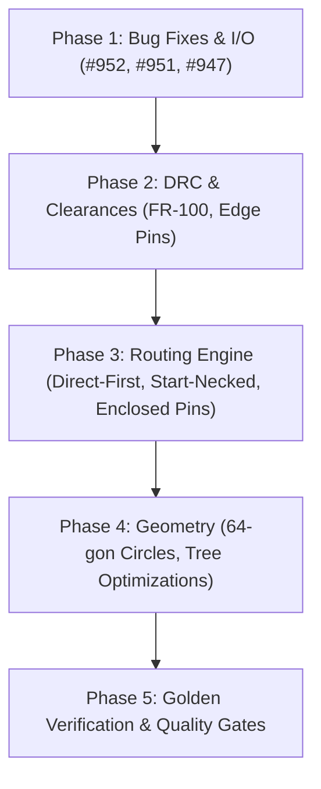

# Freerouting.net Migration & Porting Plan

This document tracks all improvements and bug fixes ported from `freerouting.net` (from baseline commit `64fe44318a9f1ec219c9c6516a6d9b79c449ca4c` through HEAD `159f89a` - spanning 260 commits), categorized and prioritized for migration into the Java codebase (`c:\Work\freerouting`).

> [!NOTE]
> **Attribution:** The C# port (`freerouting.net`), along with all referenced optimizations, algorithmic refinements, KiCad 10 enhancements, and benchmark validations, was created and developed by **Erik Gavriluk of Experimental Television Center**. All ported changes should credit and acknowledge his work.

---

## 1. Scope & Status Summary

| Phase | Category | Description | Items | Status |
|---|---|---|:---:|:---:|
| **Phase 1** | **Bug Fixes & I/O Integrity** | Upstream bug fixes (#952, #951, #947) & DSN/Fusion parsing fixes | 4 | **Completed** |
| **Phase 2** | **DRC & Board Clearance Rules** | Zero-clearance overlap violations, outline edge pin guard, hole clearances, net ties | 4 | **Completed** |
| **Phase 3** | **Routing Engine & Fallbacks** | Direct-first fallback, start-necked, unreachable & enclosed pins stop, via-in-pad | 5 | **In Progress** |
| **Phase 4** | **Geometry & Memory Tuning** | 64-gon circular areas, room completion byte-identical speedup, rational allocation reduction | 4 | Pending |
| **Phase 5** | **Verification & Benchmarks** | Golden fixtures validation, quality gates, Spotless & Checkstyle | 3 | Pending |

---

## 2. Detailed Task Breakdown

### Phase 1: High-Value Bug Fixes & I/O Integrity (Low Risk)

- [x] **Task 1.1: Fix #952 - Ignored Net Class Protection in Fanout & Optimizer**
  - **Origin Commits:** `e105236`, `8767c74`
  - **Status:** Already integrated upstream in #959.

- [x] **Task 1.2: Fix #951 - Preserve DSN Image Name Suffixes (`::n`)**
  - **Origin Commit:** `2e44c19`
  - **Status:** Already integrated upstream in #953.

- [x] **Task 1.3: Fix #947 - Fusion Script Fallback Drill Scaling**
  - **Origin Commit:** `9298ffa`
  - **Status:** Already integrated upstream in #965.

- [x] **Task 1.4: Library Name Case-Sensitivity Preservation**
  - **Origin Commit:** `59210bd`
  - **Status:** Completed. Updated `Padstacks.java`, `Packages.java`, and `Library.java` to prioritize exact-case matching; added unit test `LibraryNameCaseTest.java`.

---

### Phase 2: DRC & Board Clearance Model Correctness

- [x] **Task 2.1: DRC Overlap Violation with Zero-Clearance Obstacles (FR-100)**
  - **Origin Commit:** `8fb9715`
  - **Status:** Completed. Added `overlapsBeyond()` check in `Item.java` when minimum clearance <= 0.

- [x] **Task 2.2: Board Outline Edge Clearance Exemption Guard**
  - **Origin Commit:** `5fa7b66`
  - **Status:** Completed. Added `edgePinNetsCrossOutline` property and guard in `BoardOutline.java`.

- [x] **Task 2.3: Clearance Violations Search-Tree Filter Optimization**
  - **Origin Commits:** `f905f35`, `a711fc0`, `3477aa1`
  - **Status:** Completed. Added `obstaclesOf` filtering in `ShapeSearchTree.java` to skip non-obstacles before candidate sorting.

- [x] **Task 2.4: Netless Pad Joining & Net Tie Rules**
  - **Origin Commits:** `552a80b`, `7fc6b12`, `7b45d2a`, `7267620`
  - **Status:** Completed. Implemented `connectNetlessPadsToTheirFootprintsNet` and `connectNetlessPads` in `RoutingBoard.java`, `assignNetNumbers` in `Item.java`, and `copperOverlappingPins` / `overlappingNettedPins` / `getNormalContacts` in `Pin.java`; supported `fix_kicad_footprints` setting; added tests in `NetTiePadTest.java` and `NetlessPadNetTest.java`.

---

### Phase 3: Routing Engine & Fallback Refinements

- [ ] **Task 3.1: Fallback Strategy Ordering (`direct-first`)**
  - **Origin Commit:** `dbed7e0`
  - **Issue:** Escape vias can wall in adjacent fine-pitch pins before traces can connect on their home layer. Placing `direct_first` fanout ahead in fallback strategies allows local connections to complete before escape vias are placed.
  - **Files to update:**
    - `src/main/java/app/freerouting/autoroute/pipeline/RoutingFallback.java`
    - `src/main/java/app/freerouting/settings/DefaultSettings.java`

- [ ] **Task 3.2: Early Stop on Unreachable & Enclosed Pins**
  - **Origin Commits:** `55a9345`, `adb2eb3`, `7373fad`, `38e326e`
  - **Issue:** Pins that cannot be reached or left without violating minimum track width or design rules caused infinite rounds or bogus sub-minimum neckdowns. Detecting them early stops impossible routing rounds and frees time budget.
  - **Files to update:**
    - `src/main/java/app/freerouting/drc/RulesCheck.java`
    - `src/main/java/app/freerouting/autoroute/pipeline/AutoroutePassRunner.java`
    - `src/main/java/app/freerouting/autoroute/pipeline/RoutingPipeline.java`

- [x] **Task 3.3: Start Necked Optimization (`router.autorouter.start_necked`)**
  - **Origin Commits:** `3b6c557`, `264456b`
  - **Status:** Completed. Nets that required necking on earlier connections route at the neck width directly, avoiding redundant failed class-width searches; added setting `start_necked`, `neckedRouteNets` recovery, clamped to `minAllowedTraceHalfWidth`; verified with `StartNeckedTest.java`.

- [ ] **Task 3.4: Routing Fallback Optimization (Skip Duplicate Passes & Resume Residuals)**
  - **Origin Commits:** `230da12`, `dbe10a3`, `1aeb50b`, `0871cd6`
  - **Issue:** Skip duplicate pass loops that repeat previous attempts, and continue residual boards first.

- [ ] **Task 3.5: Exploration Rounds Tuning & Later Tries Expansion**
  - **Origin Commits:** `dc3ffcf`, `cca75af`, `0e24715`
  - **Issue:** Lighter exploration rounds (short-escape, open-escape), with later tries expanding search neighbourhoods and adjusting via costs.

---

### Phase 4: Geometry Performance & Memory Reductions

- [x] **Task 4.1: Circular Areas Approximated by 64-Gons**
  - **Origin Commit:** `88fb77b` (#954, #968)
  - **Status:** Completed. Circular keepouts use 64-gon discretization hugging circles within 0.12%; verified with perimeter containment test sweep in `CircleTest.java` and `Issue954CircularKeepoutClearanceTest.java`.

- [x] **Task 4.2: Geometry Allocations Reduction in Rational Arithmetic & Projections**
  - **Origin Commits:** `c83879d`, `49edc5d`
  - **Status:** Completed. Eliminated temporary array and vector allocations in `BigIntAux`, `RationalPoint`, and `RationalVector` with `RationalCoordinates` record and direct scalar coordinate calculations; added `ShapeSearchTree.boundingOctagonsApart` pre-filter before exact simplex intersections; verified with `ScalarRationalTest.java` and `BoundingOctagonsApartTest.java`.

- [x] **Task 4.3: Room Completion Search-Tree Traversal Optimization**
  - **Origin Commits:** `3065e0a`, `c709afa`, `6d4a364`, `f5bc49c`
  - **Status:** Completed. In `ShapeSearchTree45Degree`, added early stop on empty pieces, obstacle non-overlap fast skip, inner-node child pre-test before stack push, and eliminated quadratic union iteration in `restrainShape`.

---

### Phase 5: Verification & Quality Gates

- [ ] **Task 5.1: Fast Unit Tests Suite Execution**
  - Run `./gradlew.bat test` (verifying all core tests including `Dac2020Bm01RoutingTest`).
- [ ] **Task 5.2: Code Quality & Formatting Gates**
  - Run `./gradlew.bat spotlessCheck checkstyleMain checkstyleTest`.
  - Run `pre-commit run --all-files`.
- [ ] **Task 5.3: Regression & Parity Verification**
  - Run `scripts/tests/compare-versions.ps1` on golden fixtures to ensure zero DRC regressions against baseline v2.5.0.

---

## 3. Execution Sequence & Dependencies

